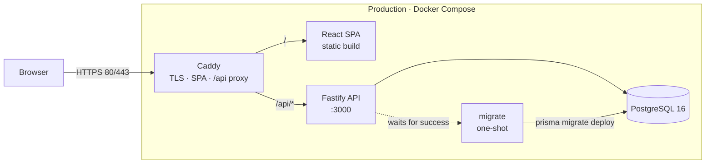

# DiscoveryLab

<p align="center">
  <a href="https://discovery.vruivo.com.br"></a>
  
  
  
</p>

**DiscoveryLab is a structured workspace where product managers turn product ideas into evidence-backed decisions.** It guides you through five proven discovery frameworks — Problem Statement, Jobs To Be Done, Opportunity Solution Tree, RICE, and a Decision Log — in one focused, session-based app.

<p align="center">
  <strong><a href="https://discovery.vruivo.com.br">Explore the live app →</a></strong>
  &nbsp;·&nbsp;
  <a href="#-features">Features</a>
  &nbsp;·&nbsp;
  <a href="#-local-development">Local development</a>
  &nbsp;·&nbsp;
  <a href="docs/decisions.md">Decisions</a>
  &nbsp;·&nbsp;
  <a href="docs/journal.md">Build journal</a>
</p>

Built as a **“Product Builder” exercise**: a product manager using an AI coding agent (DeepSeek) to take DiscoveryLab from a docs-first specification to a deployed, production-ready product.

---

## 🚀 Features

### 🔐 Authentication & workspace

- **Session-based authentication with Argon2.** Passwords are hashed with Argon2id, sessions live in PostgreSQL, and the browser only receives an `HttpOnly`, `SameSite=Lax` cookie. Login attempts are rate-limited to 10 per 15 minutes per IP, and sessions slide for 7 days.
- **Interactive dashboard and discoveries management.** See portfolio activity at a glance, then create, open, update, and soft-delete discoveries. Every discovery carries a lifecycle (`draft`, `active`, `completed`, `archived`) plus creator and lead context.
- **A guided, non-blocking workflow.** The five stages — Frame → Understand → Explore → Prioritize → Decide — are always visible, but never enforced. Jump to any stage at any time; progress is shown, not gated.

### 🧭 Five discovery frameworks

| Framework                           | Stage      | What it captures                                                               |
| ----------------------------------- | ---------- | ------------------------------------------------------------------------------ |
| **Problem Statement**               | Frame      | The problem, who is affected, why now, constraints, and success criteria.      |
| **Jobs To Be Done (JTBD)**          | Understand | Job statements, segments, and notes behind the underlying need.                |
| **Opportunity Solution Tree (OST)** | Explore    | Outcomes, opportunities, solutions, and experiments in one branching tree.     |
| **RICE**                            | Prioritize | Reach, impact, confidence, and effort for each opportunity, with a live score. |
| **Decision Log**                    | Decide     | The decision, rationale, date, and owner — so the reasoning survives.          |

### ⚡ From thinking to output

- **Live RICE scoring.** The score updates as you type: `(Reach × Impact × Confidence) / Effort`. The API recalculates and persists the same score on save, so the database stays authoritative.
- **Server-side Markdown export.** Turn a complete discovery into a clean Markdown brief in one click. The API assembles the document from the database; the web app downloads it as a `.md` file.
- **Production-ready Docker & Caddy deployment.** Multi-stage images, a one-shot migration service, persisted Postgres data, and automatic HTTPS through Caddy. The entire production stack is one Compose file.

> [!NOTE]
> **No AI in the product.** DiscoveryLab v1 is intentionally a deterministic thinking tool: no model calls, no token costs, no opaque suggestions. AI was the build tool, not a runtime dependency.

---

## 🛠 Tech Stack

<p align="center">
  
  
  
  
  
  
  
  
  
</p>

| Layer              | Technologies                                                                                                 |
| ------------------ | ------------------------------------------------------------------------------------------------------------ |
| **Frontend**       | React 19 · Vite 8 · Tailwind CSS 4 · shadcn/ui · TanStack Query 5 · React Hook Form · Zod 4 · React Router 7 |
| **Backend**        | Node.js 22 · Fastify 5 · Prisma 7.10 · Zod 4 · Pino · Argon2id                                               |
| **Database**       | PostgreSQL 16 — relational core, with JSONB for framework payloads                                           |
| **Infrastructure** | Docker · Docker Compose · Caddy 2 (automatic HTTPS)                                                          |
| **Monorepo**       | pnpm workspaces · TypeScript strict mode                                                                     |

**Engineering conventions:** Zod at every boundary, a `routes → service → repo` backend, feature-first frontend folders, and Conventional Commits. Shared schemas provide both runtime validation and inferred TypeScript types.

---

## 📂 Architecture

```text
discoverylab/
├── apps/
│   ├── web/                    # React SPA (Vite, Tailwind, shadcn/ui)
│   └── api/                    # Fastify API at /api/v1
│       ├── prisma/             # Schema and SQL migrations
│       └── src/modules/        # auth · discoveries · frameworks · export
├── packages/
│   └── shared/                 # Zod schemas + TS types (used by web & api)
├── docs/
│   ├── decisions.md            # The contract: stack, scope, conventions
│   ├── plan.md                 # Milestones and delivery rules
│   └── journal.md              # The real build log, including mistakes
├── Caddyfile                   # SPA fallback + /api reverse proxy
├── docker-compose.yml          # Local PostgreSQL 16
└── docker-compose.prod.yml     # db · migrate · api · web
```

- **`apps/web`** — React frontend (Vite). Protected routes, a dashboard, the discovery workspace, and autosaving forms built with TanStack Query, React Hook Form, and Zod.
- **`apps/api`** — Fastify backend. Session auth, ownership-scoped CRUD, RICE computation, markdown export, and a health endpoint with database reachability.
- **`packages/shared`** — Shared Zod schemas and TypeScript types. One contract for forms, requests, and responses; it also owns the RICE score helper.
- **`docs/`** — The PM's brain: `decisions.md`, `plan.md`, and `journal.md`.

### How a request flows



- **Development:** the browser talks to Vite on `:5173`; Vite proxies `/api` to Fastify on `:3000`, which talks to Postgres on `:5432`. No CORS friction.
- **Production:** the browser talks only to Caddy. Caddy serves the SPA and proxies `/api/*` to Fastify. Each hostname is a single origin, so session cookies stay first-party.

### API surface

| Methods                  | Endpoint                                     | Purpose                                    |
| ------------------------ | -------------------------------------------- | ------------------------------------------ |
| `POST`                   | `/api/v1/auth/signup` · `/login` · `/logout` | Create, start, and end a session.          |
| `GET`                    | `/api/v1/auth/me`                            | Current authenticated user.                |
| `GET`, `POST`            | `/api/v1/discoveries`                        | List and create discoveries.               |
| `GET`, `PATCH`, `DELETE` | `/api/v1/discoveries/:id`                    | Read, update, and soft-delete.             |
| `GET`                    | `/api/v1/discoveries/:id/frameworks`         | List framework instances.                  |
| `GET`, `PUT`             | `/api/v1/discoveries/:id/frameworks/:key`    | Read or idempotently upsert one framework. |
| `GET`                    | `/api/v1/discoveries/:id/export`             | Server-generated Markdown brief.           |
| `GET`                    | `/api/v1/health`                             | Liveness plus database reachability.       |

Both apps consume `@discoverylab/shared`, so the same Zod schema validates browser input and server payloads. Errors use one shape across the API:

```json
{ "error": { "code": "VALIDATION_ERROR", "message": "...", "details": [] } }
```

---

## 💻 Local Development

### Prerequisites

| Tool        | Version    | Notes                                                                            |
| ----------- | ---------- | -------------------------------------------------------------------------------- |
| **Node.js** | 22+        | Pinned to 22 in `.nvmrc`; Docker images use `node:22-alpine`.                    |
| **pnpm**    | 12.15.0    | The version used by the production Docker builds: `npm install -g pnpm@12.15.0`. |
| **Docker**  | Current    | Docker Engine with the Compose plugin, for PostgreSQL 16.                        |
| **Git**     | Any recent | To clone the repository.                                                         |

### 1. Clone and install

```bash
git clone https://github.com/victorgruivo-coder/discoverylab.git
cd discoverylab
pnpm install
```

### 2. Configure the environment

```bash
cp apps/api/.env.example apps/api/.env
cp apps/web/.env.example apps/web/.env
```

The defaults are ready for local work: the API points at the Compose Postgres, listens on `3000`, and allows `http://localhost:5173`. The web app uses `VITE_API_URL=/api/v1`, which Vite proxies to the API. Both `.env` files are gitignored.

### 3. Start the database

```bash
sudo docker compose up -d
```

This starts PostgreSQL 16 on `localhost:5432` with database, user, and password all set to `discoverylab`. If your user is in the `docker` group — or you use Docker Desktop — omit `sudo` from these commands; otherwise prefix them with `sudo`. Confirm the database is healthy with `docker compose ps` (add `sudo` if needed).

### 4. Run the migrations

```bash
pnpm --filter @discoverylab/api exec prisma migrate dev
```

This applies the migrations in `apps/api/prisma/migrations` and generates the Prisma client. Prisma 7 reads its datasource from `apps/api/prisma.config.ts`, which loads `apps/api/.env` automatically.

### 5. Build the shared package

```bash
pnpm build
```

The root build runs in dependency order: `packages/shared` first, then `apps/api` and `apps/web`. Both apps import shared from its built `dist/`, so run this once before the first dev start.

> [!TIP]
> To rebuild only the shared package after changing it:
> `pnpm --filter @discoverylab/shared build`

### 6. Start the dev servers

```bash
pnpm dev
```

This runs Fastify with `tsx watch` on `:3000` and Vite on `:5173` in parallel.

### 7. Open the app

- **App:** [http://localhost:5173](http://localhost:5173)
- **API health:** [http://localhost:3000/api/v1/health](http://localhost:3000/api/v1/health) → `{"ok":true,"db":"up"}`

> [!NOTE]
> There are no seeded users. Create an account at `/signup` on first run. Data persists in the `postgres_data` Docker volume across restarts.

### Useful commands

| Command                                        | What it does                                 |
| ---------------------------------------------- | -------------------------------------------- |
| `pnpm dev`                                     | Start the API and web dev servers.           |
| `pnpm build`                                   | Build shared, API, and web for production.   |
| `pnpm typecheck`                               | Strict TypeScript check across all packages. |
| `pnpm lint`                                    | Run ESLint.                                  |
| `pnpm format` / `pnpm format:check`            | Write or verify Prettier formatting.         |
| `pnpm --filter @discoverylab/api db:migrate`   | Shorthand for `prisma migrate dev`.          |
| `pnpm --filter @discoverylab/api db:studio`    | Open Prisma Studio.                          |
| `pnpm --filter @discoverylab/api verify:enums` | Verify Prisma enums match the shared enums.  |

> [!TIP]
> If `@discoverylab/shared` cannot be resolved, run `pnpm build`. If Postgres refuses connections, check `sudo docker compose ps` and start it with `sudo docker compose up -d`.

---

## 🌍 Production Deployment (Self-Hosted)

The production stack is a single Compose project on one Linux host. Caddy is the only service exposed to the internet: it serves the React build, reverse-proxies `/api`, and manages TLS. PostgreSQL and the API stay on the private Compose network.

### 1. Prepare the server

- Install **Docker Engine** with the **Compose v2** plugin.
- Open inbound **TCP 80 and 443** in the firewall. Caddy needs both for certificate issuance and renewal.
- Point a DNS **A/AAAA record** for each public hostname at the server.
- Install **Git**.

### 2. Clone the repository and check out `main`

```bash
git clone https://github.com/victorgruivo-coder/discoverylab.git
cd discoverylab
git checkout main
```

### 3. Create `.env.prod`

```bash
cp .env.prod.example .env.prod
```

Edit `.env.prod` before starting anything. It is gitignored, so real secrets never enter the repository.

- **`POSTGRES_USER` / `POSTGRES_PASSWORD` / `POSTGRES_DB`** — initialize the bundled database. Use a long, random password.
- **`DATABASE_URL`** — must match those credentials and use `db` as the host: `postgresql://discoverylab:<password>@db:5432/discoverylab?schema=public`. Percent-encode special characters in the password.
- **`DOMAINS`** — comma-separated hostnames Caddy serves, with no scheme. Example: `localhost,192.168.0.9,discovery.example.com`.
- **`WEB_ORIGINS`** — the same hosts as full HTTPS origins for the API CORS allow-list. Example: `https://localhost,https://192.168.0.9,https://discovery.example.com`.
- **`LOG_LEVEL`** — Pino log level; `info` is a good production default.

> [!IMPORTANT]
> **Caddy handles HTTPS automatically.** For every public hostname, Caddy requests and renews a Let's Encrypt certificate on first boot and stores it in the `caddy_data` volume. The name must resolve to the server and ports 80/443 must be reachable — no Certbot, cron job, or manual certificate files.
>
> `localhost` and private IPs use Caddy's internal CA instead; trust its root or accept the browser warning for those hosts (some mobile browsers reject self-signed certificates outright). Because production cookies are `Secure`, every entry in `DOMAINS` is served over HTTPS, and `WEB_ORIGINS` must use `https://`.

Keep `DOMAINS` and `WEB_ORIGINS` in sync. When you add a hostname, add it to both lists and recreate the `web` and `api` containers.

### 4. Launch the stack

```bash
docker compose -f docker-compose.prod.yml --env-file .env.prod up -d --build
```

Boot order is enforced by Compose:

1. `db` starts and passes its healthcheck.
2. The one-shot `migrate` service runs `prisma migrate deploy` and exits `0`.
3. `api` starts and passes its healthcheck.
4. `web` (Caddy) starts, obtains certificates, and serves the app.

**Migrations are automatic.** There is no manual migration step in production: the `migrate` service builds from the API builder stage, which has the Prisma CLI, and `api` waits for it to complete successfully.

### 5. Verify and update

```bash
# Container status
docker compose -f docker-compose.prod.yml --env-file .env.prod ps

# Follow API logs (Ctrl+C to stop following)
docker compose -f docker-compose.prod.yml --env-file .env.prod logs -f api

# Health check (replace with your domain)
curl -fsS https://discovery.example.com/api/v1/health
```

A healthy API returns `{"ok":true,"db":"up"}`. Then open the domain and create the first account.

To deploy a new version:

```bash
git pull
docker compose -f docker-compose.prod.yml --env-file .env.prod up -d --build
```

New migrations run automatically, and Caddy's certificates persist across rebuilds.

### Operational notes

- Only `web` publishes host ports (`80:80`, `443:443`); PostgreSQL and the API are reachable only on the internal Compose network.
- `postgres_data` holds the database. `caddy_data` and `caddy_config` hold certificates and account state — keep all three volumes.
- `.env.prod` is ignored by git; never commit real secrets.
- To use a managed Postgres (Neon, Supabase), point `DATABASE_URL` at it with `?sslmode=require` and remove the `db` service plus its `depends_on` entries from `docker-compose.prod.yml`.

> [!WARNING]
> `docker compose down` keeps named volumes, but `docker compose down -v` permanently deletes the database and Caddy state. Back up before any destructive operation.

---

## 🧠 The "Product Builder" Methodology

DiscoveryLab is also a public record of **how** it was built. The repository ships the actual working documents used during development — not a cleaned-up retrospective.

| Document                                     | Role                                                                                                                          |
| -------------------------------------------- | ----------------------------------------------------------------------------------------------------------------------------- |
| **[`docs/decisions.md`](docs/decisions.md)** | **The contract.** Product scope, data shapes, auth, stack, deployment, and conventions. Every AI session starts here.         |
| **[`docs/plan.md`](docs/plan.md)**           | **The plan.** Milestones, delivery rules, and the shape of each session.                                                      |
| **[`docs/journal.md`](docs/journal.md)**     | **The journal.** What was built, which decisions were made, and what broke — including agent mistakes and rejected shortcuts. |

> “This file is the contract. Every AI coding session reads it first. When a decision changes, update this file, not the conversation.”
>
> — `docs/decisions.md`

### How the build worked

1. **Milestone-based prompting.** One milestone per session, with self-contained context, explicit scope, acceptance criteria, and a “do not” list. Work outside the milestone was stopped.
2. **Docs as the contract.** The stack, data model, and deployment target were locked in `decisions.md` before code. Later sessions inherited the document, not the chat history.
3. **Human review at every gate.** The PM read every file, ran the acceptance checks, manually tested the UX, handled the infrastructure steps, and committed once per milestone.
4. **A journal, not a highlight reel.** Each milestone ended with three bullets: what I built, one decision and why, one surprise or breakage. The failures stayed in.

The code was written largely by **DeepSeek** acting as an AI coding agent (via DeepSeek Harness). Product decisions, scope control, review, QA, and deployment stayed with the PM. That division is the exercise: use AI for leverage without outsourcing judgment.

**Start here:** [read the decisions](docs/decisions.md) · [see the plan](docs/plan.md) · [read the build journal](docs/journal.md)

---

<p align="center">
  <sub>DiscoveryLab v1.0.0 · Built by a PM with an AI copilot · <a href="https://discovery.vruivo.com.br">discovery.vruivo.com.br</a></sub>
</p>
